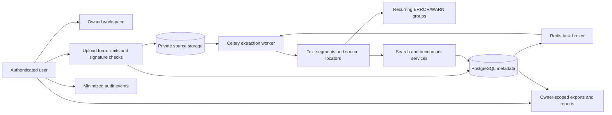

# LogLens architecture

## Application boundaries

The Django project is split into six apps. See the [entity relationship diagram](erd.md) for the current model relationships and [sample-data provenance](sample-data.md) for the checked-in fixtures:

| App | Responsibility |
| --- | --- |
| `accounts` | Django roles, access decorators, audit events, and the audited role-management view |
| `workspaces` | Owner-bound workspace creation and dashboard aggregation |
| `ingestion` | Upload validation, private storage, parser adapters, source segments, Celery extraction, deletion |
| `search` | Literal algorithms, Unicode normalization, persisted runs, saved searches, indicators, recurring error groups |
| `benchmarks` | Repeated in-memory algorithm measurements and persisted metrics |
| `reports` | Owner-scoped benchmark analysis and CSV/JSON output |

## Data flow

Uploaded data is stored outside the static tree under `PRIVATE_MEDIA_ROOT`. The database stores a random storage key and its private path; there is no user-upload media route. Source files, segments, search results, benchmarks, saved searches, and reports follow Django foreign-key cascades. Removing a source file also recomputes or removes affected error groups and schedules the original bytes for purge after the database transaction commits.

Text, PDF, and Word parsers retain source locators as line, page, paragraph, or table-cell metadata. Legacy `.doc` parsing uses a headless LibreOffice subprocess with a private temporary profile, a non-root worker, a timeout, and container CPU/memory/PID limits.

## Trust boundaries

- Browser-supplied filenames are display-only. Storage names are generated UUID keys and accepted extensions are allow-listed.
- Views scope access by the authenticated owner before loading records. The workspace owner is checked again in services that create search, benchmark, error-group, or audit records.
- Admin can review the most recent audit events across accounts. Audit detail is minimized and excludes source text and credentials; events are append-only in the application UI/admin. Django admin cannot edit/delete workspaces or source files and cannot directly change application role groups, preserving application lifecycle and audit hooks.
- Production TLS terminates at a trusted ingress in front of the loopback-bound Nginx service. That ingress must overwrite `X-Forwarded-Proto`, set the public `Host`, and forward only to the host-local port. Django trusts the forwarded HTTPS header only in production.
- Celery messages use JSON serialization. Redis is password-authenticated on the internal Compose network, has no published host port, and persists its broker queue to a named volume.

## Roles

`Admin` can access the application-wide audit view and role-management screen. `Analyst` can create workspaces, upload, search, and benchmark. `Reviewer` can use read-only views. A Django superuser is treated as an application Admin. An Admin assigns roles from the CSRF-protected `/accounts/roles/` screen; a superuser cannot be demoted through that screen, and an Admin cannot remove their own Admin access.
