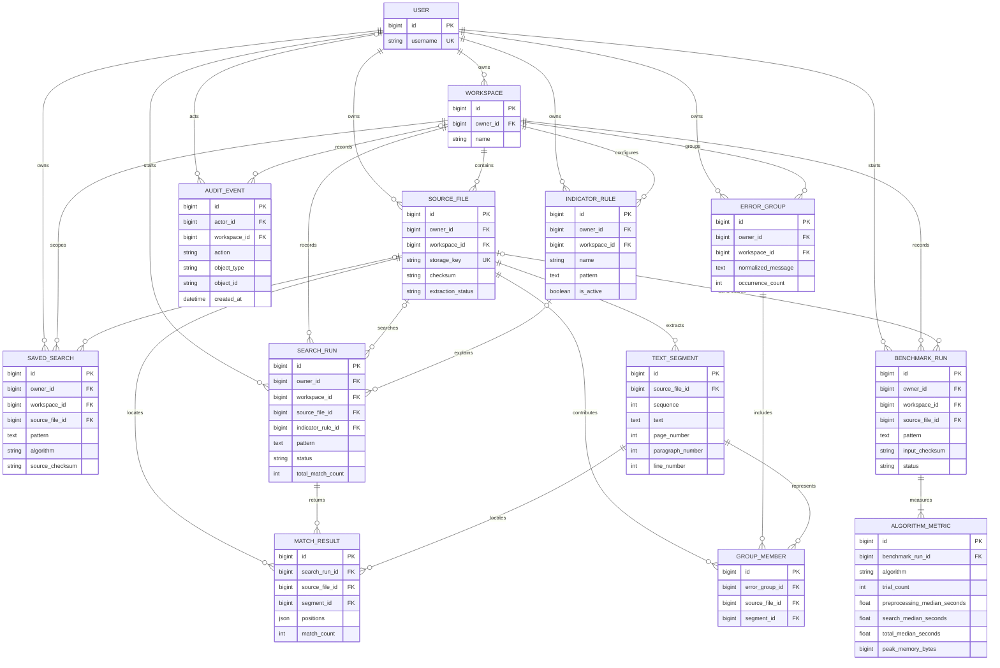

# LogLens entity relationship diagram

This diagram records the repository's current relational model. User-owned data remains isolated by owner checks in views and services. A `Workspace` is currently owned by one user; reviewer sharing and membership tables are not implemented.

The current schema stores saved configurations and execution records independently; it does not maintain a foreign key from a rerun to its saved-search record. `SearchRun` and `SavedSearch` each target one source file today; multi-file scopes remain a product gap.
